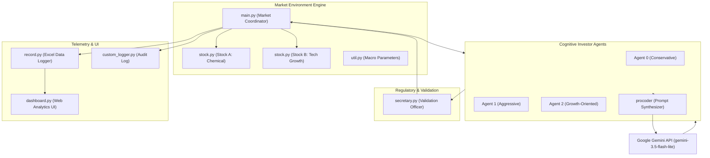

# StockAgent: LLM-Based Multi-Agent Stock Market Trading Simulation

[](https://www.python.org/downloads/)
[](https://ai.google.dev/)
[](https://opensource.org/licenses/MIT)

**Author & Project Developer:** Ruchil Parkar  
**Repository:** [https://github.com/RuchilParkar/StockAgent.git](https://github.com/RuchilParkar/StockAgent.git)  

---

## 📌 Project Overview

**StockAgent** is an advanced multi-agent artificial intelligence simulation system that models realistic financial stock trading environments using Large Language Models (LLMs) as autonomous investor agents. 

Unlike traditional quantitative agent-based models (ABMs) that rely on static mathematical heuristics, StockAgent empowers each AI trader with:
- **Autonomous Financial Statement Analysis**: Comprehends quarterly corporate balance sheets, revenue growth, cash flows, and operating expense ratios.
- **Heterogeneous Investor Personalities**: Models distinct risk preferences including **Conservative**, **Aggressive**, and **Growth-Oriented** traders.
- **Macroeconomic & Credit Dynamics**: Evaluates tiered benchmark loan interest rates (1-yr @ 2.7%, 2-yr @ 3.0%, 3-yr @ 3.3%) to dynamically manage leverage.
- **Social Sentiment Diffusion**: Agents communicate strategic reflections on a public forum, influencing market expectations across trading days.

---

## 🚀 Key Implementations & Enhancements by Ruchil Parkar

1. **Google Gemini Unified SDK Integration**:
   - Modernized the system from deprecated legacy OpenAI APIs to Google's official **`google-genai` SDK (v1.47.0)**.
   - Configured high-speed, zero-throttling reasoning using **`gemini-3.5-flash-lite`**.
   - Zero hardcoded credentials: secure runtime resolution via process environment variables (`GOOGLE_API_KEY`).

2. **Interactive Financial Analytics Web Dashboard (`dashboard.py`)**:
   - Built a standalone, zero-dependency local web dashboard running on `http://localhost:5000`.
   - Features real-time Chart.js visualizations, portfolio breakdowns, order book clearing matrices, and live audit telemetry.

3. **C-ABI & Modern Library Compatibility**:
   - Resolved NumPy 2.0 binary compatibility crashes (`ValueError: numpy.dtype size changed`) with Pandas 1.3.5 by pinning stable `numpy==1.26.4` and `openpyxl==3.1.5`.

4. **Multi-Phase Market Lifecycle Engine**:
   - Implemented deterministic 4-phase trading days: **Debt Management**, **Session Trading & Clearing**, **Next-Day Forecasting**, and **Social Sentiment Exchange**.
   - Enforced mathematical constraint validation via `secretary.py` (checking cash bounds, holdings limits, and schema conformance).

5. **Automated Data Persistence & Telemetry**:
   - Automatically exports granular trade logs and balance sheets into Excel workbooks (`agent_day_record.xlsx`, `agent_session_record.xlsx`, `stocks.xlsx`, `trades.xlsx`).

---

## 🏗️ System Architecture



---

## 📊 Investor Risk Profiles

| Agent | Risk Character | Core Investment Strategy | Credit & Leverage Behavior |
|:---:|:---:|---|---|
| **Agent 0** | **Conservative** | Capital preservation, debt-averse, holds positions during volatility. | Takes minimal/modest loans; ceases borrowing when market stagnates. |
| **Agent 1** | **Aggressive** | Maximum equity accumulation in high-growth technology assets. | Exercises maximum borrowing capacity ($3.0M loan) to maintain purchasing power. |
| **Agent 2** | **Growth-Oriented** | Disciplined fundamental analysis targeting revenue and positive cash flow. | Balances debt and equity ($2.0M loan) to acquire undervalued growth assets. |

---

## ⚙️ Installation & Setup

### Prerequisites
- Python 3.9 (recommended: Python 3.9.13)
- Active Google Gemini API Key

### 1. Clone the Repository
```bash
git clone https://github.com/RuchilParkar/StockAgent.git
cd StockAgent
```

### 2. Create and Activate Virtual Environment
```powershell
python -m venv .venv
.\.venv\Scripts\Activate.ps1
```

### 3. Install Dependencies
```bash
pip install -r requirements.txt
```

### 4. Configure Google Gemini API Key
```powershell
$env:GOOGLE_API_KEY = "YOUR_GEMINI_API_KEY"
```

---

## 🚦 Running the Simulation

### Start Multi-Agent Trading
Run the verified 3-agent, 2-day simulation:
```bash
python main.py --model gemini-3.5-flash-lite --agents 3 --days 2 --sessions 1
```

### Launch the Analytics Web Dashboard
Launch the interactive web UI at `http://localhost:5000`:
```bash
python dashboard.py
```

---

## 📁 Repository Structure

```text
StockAgent/
├── agent.py               # LLM investor agent cognition and decision logic
├── dashboard.py           # Standalone visual analytics web dashboard
├── main.py                # Market coordinator, clocks, and order clearing engine
├── record.py              # Excel telemetry logger (pandas / openpyxl)
├── secretary.py           # Regulatory officer enforcing JSON schema and constraints
├── stock.py               # Financial asset models (Stock A & Stock B)
├── util.py                # Macro parameters, interest rates, and Gemini client
├── requirements.txt       # Project dependencies
├── StockAgent_College_Demonstration_Report.md # Full technical verification report
├── prompt/
│   └── agent_prompt.py    # Modular prompt definitions using procoder
├── log/
│   └── custom_logger.py   # Colored terminal logging and test.txt persistence
└── res/                   # Persistent Excel output ledgers (*.xlsx)
```

---

## 📜 Academic Attribution & References

This implementation is developed and modernized by **Ruchil Parkar**, building upon the foundational multi-agent financial market research:

* **Foundational Paper:** Zhang, C., Liu, X., Zhang, Z., Jin, M., Li, L., Wang, Z., Hua, W., Shu, D., Zhu, S., Jin, X., et al. (2024). *When AI Meets Finance (StockAgent): Large Language Model-based Stock Trading in Simulated Real-world Environments*. Accepted by the **ACM Transactions on Intelligent Systems and Technology (ACM TIST)**, [arXiv:2407.18957](https://arxiv.org/abs/2407.18957).
* **PromptCoder Framework:** Modular Prompt Management Library, [https://github.com/dhh1995/PromptCoder](https://github.com/dhh1995/PromptCoder).

---

## 📄 License
This project is licensed under the MIT License - see the [LICENSE](LICENSE) file for details.
